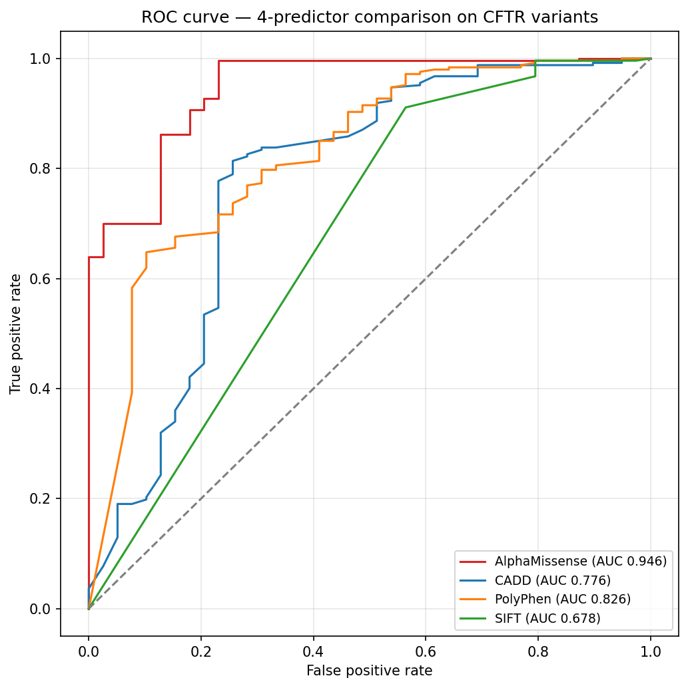
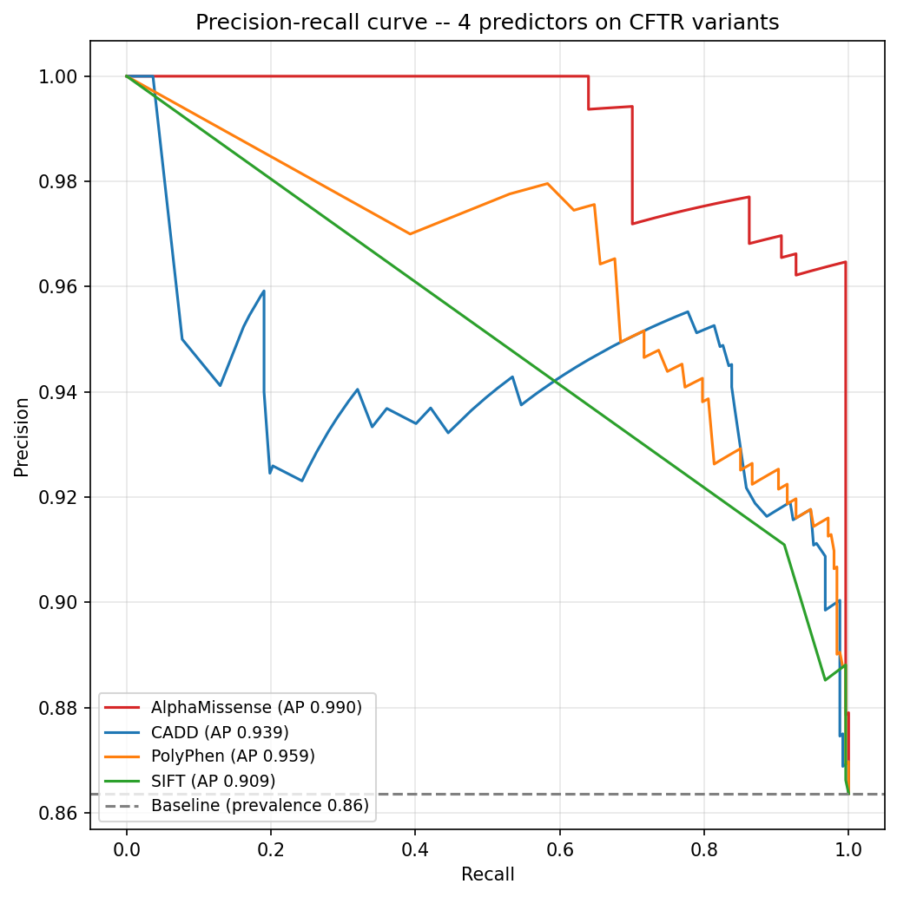
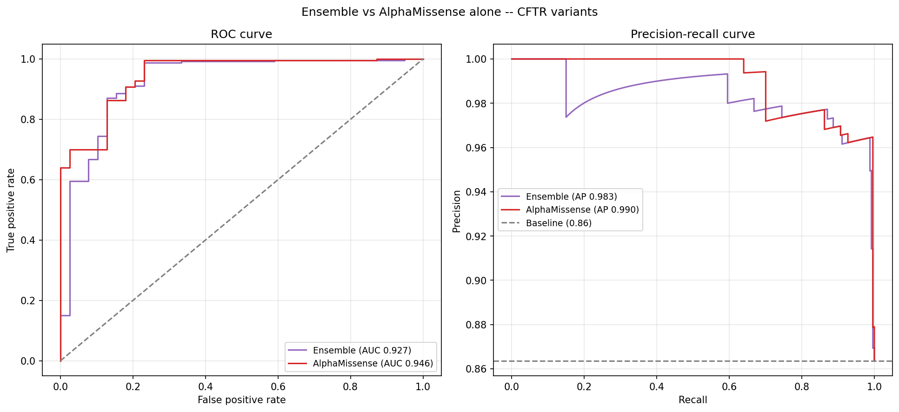
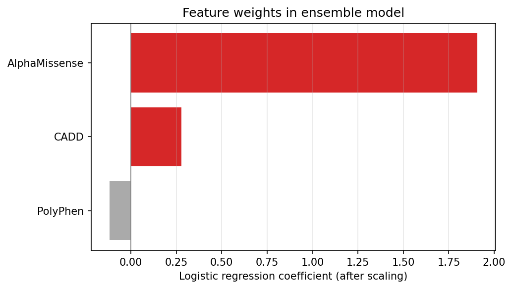
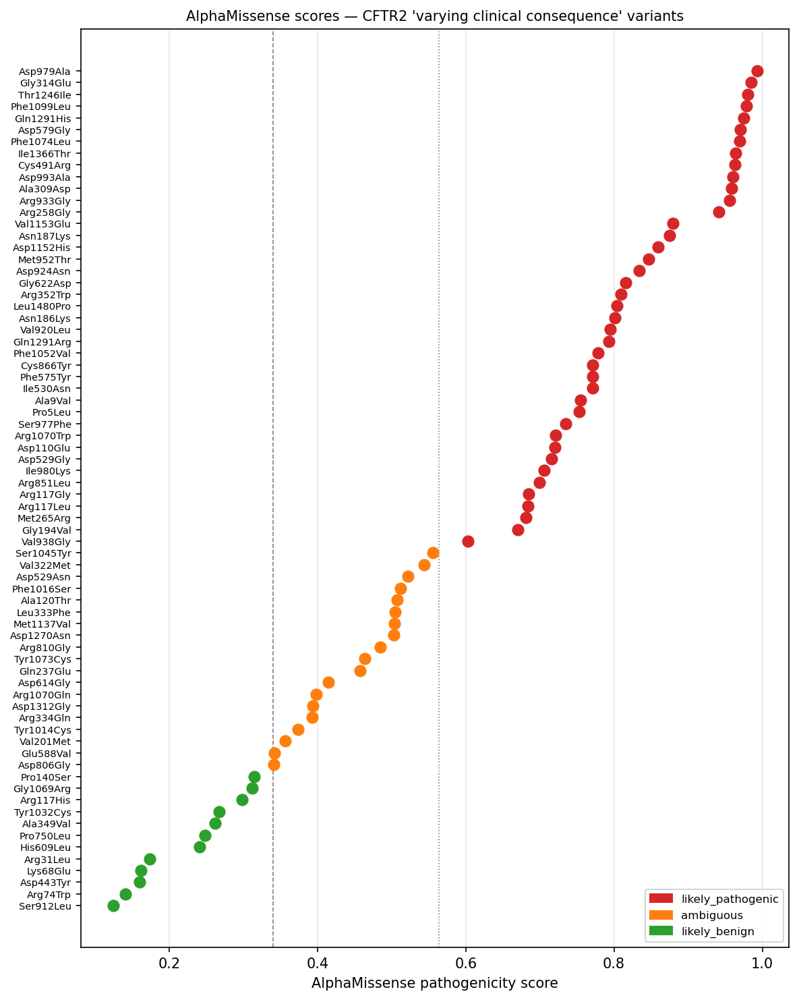
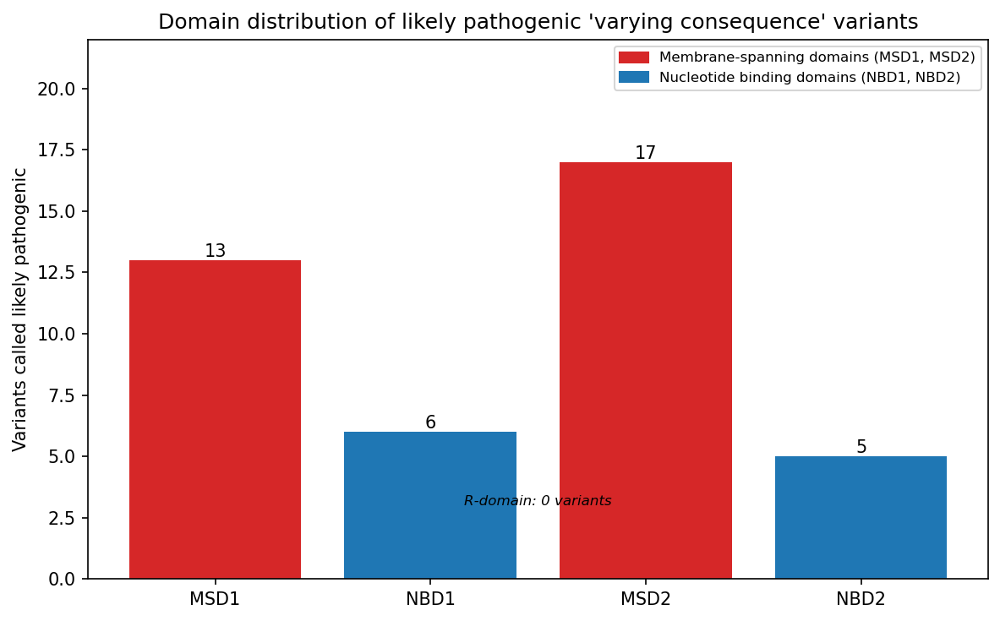

# AlphaMissense annotation for CFTR variants

## Why this exists

The CFTR2 pipeline matched 650 of 2,782 variants. 77% had no CFTR2 classification.

CFTR2 only includes variants seen in enough CF patients to characterise. Most CFTR variants submitted to ClinVar are rare: they exist in clinical reporting databases but have not been seen in enough CF patients to receive a CFTR2 classification.

But it raises a question. What are those 2,132 variants?

AlphaMissense predicts pathogenicity for every possible human missense variant. It was built from protein structure and evolutionary data, not from CFTR2. That independence matters. If its predictions agree with CFTR2 on the variants we do have labels for, we can apply it to the ones we do not.

We checked that first. AUC 0.9550 on 257 unique labelled CFTR variants (`results/phase1/am_validation_metrics.csv`). Good enough to use. We then ran it on the unclassified variants and found 489 unique variants (rows: 628) predicted likely pathogenic with no clinical classification anywhere. We also looked at the 72 variants CFTR2 itself marks as uncertain. That turned out to be the most interesting part.

Requires `cftr2_results.csv` from `cftr2_scraper.ipynb`.

## Repository layout

The paper is `docs/paper/manuscript.md`. Everything else is organised around it.

| Location | What it holds |
|---|---|
| `docs/paper/`, `scripts/paper/`, `results/paper/`, `figures/paper/` | The manuscript, its tables, the scripts that produce its analyses and figures, and their outputs |
| `scripts/`, `results/phase1/`, `results/alphagenome/`, `results/*.csv`, `notebooks/` | The scripts, notebooks and results files the paper's analyses rest on |
| `scripts/b1_*`, `scripts/b2*`, `scripts/gwas_loci.py`, `results/gwas_modifiers/`, `docs/option_b_draft.md` | Option B: AlphaGenome scoring of CF lung-disease modifier loci |
| `audit/`, `docs/AUDIT_RECORD.md`, `docs/STATUS.md`, `quarantine/` | The integrity audit trail and project status |
| `archive/` | Retracted, superseded and side analyses. Each folder has a `MANIFEST.md` mapping old paths to new ones: `archive/retracted-2026-07/`, `archive/superseded-2026-10/`, `archive/side-analyses/`, and the earlier `archive/audit-2026-07/` |

Sections below this one describe the project's history. Some refer to files now in `archive/`.

> **Updated 2026-10-29.** Inventory and benchmark numbers in this file come from the rebuild after the protein-name extractor fix (`docs/AUDIT_RECORD.md`, Corrections 14; `results/phase1/unique_variant_counts.csv`, `am_validation_metrics.csv`, `benchmark_metrics_dedup.csv`). The ACMG/LLM side experiment below was run on the earlier 259-variant set and was not repeated.

## Data provenance

The variant set is the CFTR region of a ClinVar VCF (GRCh38; `##fileDate 2026-04-15`), extracted 21 April 2026 with bcftools (VCF header L79) and annotated with the VEP v115.1 cache carrying ClinVar 202502 annotations. The input is a ClinVar extract: VCF header `##source=ClinVar`, sites-only (no sample columns). Its allele-frequency field is 1000 Genomes Phase 3 (`AF_TGP`); the VCF carries no gnomAD frequencies.
Pipeline: ClinVar full download → `bcftools view -r 7:117480000-117670000` → `bcftools norm` → VEP v115.1 annotation on GRCh38.p14.
The VCF contains 5,923 data lines; the scraper extracts 2,782 unique protein changes (2,473 convertible missense names and 309 nonsense names; `results/phase1/unique_variant_counts.csv`) by applying a protein-change regex to the CSQ annotation, accepting a name only when the HGVSp token is complete, and deduplicating (`scripts/cftr2_scraper_analysis.py`, `scripts/hgvsp_names.py`).
The VCF carries no patient-level data.
See [audit/COHORT_PROVENANCE.md](audit/COHORT_PROVENANCE.md).

## What is AlphaMissense

AlphaMissense is a pathogenicity predictor from Google DeepMind. It assigns a score between 0 and 1 to every possible human missense variant. The scores are pre-computed and published as a downloadable dataset. No model needs to be run locally.

## What this does

1. Downloads the AlphaMissense hg38 dataset and filters it to CFTR variants only (UniProt P13569)
2. Converts VCF variant names from three-letter amino acid format (`Ser13Phe`) to single-letter format (`S13F`) to match AlphaMissense convention
3. Merges scores into the CFTR2 results
4. Validates AlphaMissense predictions against CFTR2 ground truth
5. Flags unclassified variants predicted likely pathogenic
6. Cross-references flags with population frequency from the VCF (1000 Genomes Phase 3, field AF_TGP; `notebooks/alphamissense.ipynb` cell 17, `AF_INDEX = 34`)
7. Analyses the "varying clinical consequence" group

## Results

### Validation

| Metric | Value |
|---|---|
| Variants used (unique) | 257 |
| AUC | 0.9550 |
| Average Precision | 0.9924 |
| Accuracy (threshold 0.564) | 0.926 |
| CF-causing F1 (threshold 0.564) | 0.957 |
| Non CF-causing F1 (threshold 0.564) | 0.740 |

Source: `results/phase1/am_validation_metrics.csv`. AlphaMissense agrees with CFTR2 clinical classifications at AUC 0.9550. The weaker F1 on Non CF-causing is expected. Only 33 such unique variants were available.

**Self-audit correction.** After removing 33 duplicated rows (one-to-many merge on protein variant name), AUC is 0.955 on 257 unique variants (`results/phase1/am_validation_metrics.csv`). The class split is 224 CF-causing vs 33 Non CF-causing. The comparator and ensemble tables below were re-run on 2026-10-29 after the protein-name extractor fix (`results/phase1/benchmark_metrics_dedup.csv`, `delong_tests_dedup.csv`); the superseded 286-row and 254-variant values are listed in `docs/AUDIT_RECORD.md`, Corrections (2026-10), items 9 and 14.

Note on class imbalance: 224 CF-causing vs 33 Non CF-causing unique variants (rows before deduplication: 251 vs 39). The overall accuracy is partly inflated by this. The AUC is the more reliable metric here.

### Comparison against CADD, PolyPhen, and SIFT

We benchmarked AlphaMissense against three predictors on the 257 unique validation variants, all of which have all four scores (`results/phase1/benchmark_metrics_dedup.csv`). Before the 2026-10-29 extractor fix, five variants lacked a CADD v1.7 score because CADD was queried at frameshift coordinates (`docs/AUDIT_RECORD.md`, Corrections 14). CADD scores were fetched via the REST API. SIFT and PolyPhen were extracted from the CSQ field of the VCF.

| Predictor | AUC (ROC) | Average Precision (PR) |
|---|---|---|
| AlphaMissense | 0.955 | 0.992 |
| PolyPhen | 0.812 | 0.957 |
| CADD | 0.750 | 0.934 |
| SIFT | 0.671 | 0.912 |

The PR curve is the more informative metric here. The 257-variant benchmark set is 224 CF-causing vs 33 Non CF-causing (`benchmark_metrics_dedup.csv`, columns n_pos / n_neg) -- ROC is optimistic on imbalanced data. On PR, AlphaMissense leads by 4 points over PolyPhen and maintains clean precision across the full recall range. CADD's curve is jagged at low recall -- it makes confident wrong calls at high score thresholds.

CADD and PolyPhen are gene-agnostic. SIFT uses sequence conservation but no structural context. AlphaMissense draws on protein language model representations trained on evolutionary data across the full proteome. On a well-studied gene with a known 3D structure, that depth of representation is the advantage.





### Ensemble model

We tested whether combining AlphaMissense, CADD, and PolyPhen in a logistic regression would outperform AlphaMissense alone. Stratified 5-fold cross-validation on the same 257 unique variants; deduplication precedes fold assignment (`results/phase1/benchmark_metrics_dedup.csv`, row `Ensemble_CV`).

| Model | AUC | AP |
|---|---|---|
| AlphaMissense alone | 0.955 | 0.992 |
| Ensemble (AM + CADD + PolyPhen) | 0.942 | 0.989 |

The ensemble is worse. Feature weights after scaling: AlphaMissense +2.110, CADD +0.008, PolyPhen -0.050. The model learns to ignore CADD and discount PolyPhen. AlphaMissense already captures what they offer. Adding them introduces noise.





### Unclassified variants

Of the 2,132 variants not in CFTR2, 1,821 unique variants had AlphaMissense scores (rows: 2,172; `results/phase1/unique_variant_counts.csv`).

| AlphaMissense class | Unique variants | Rows |
|---|---|---|
| likely_benign | 1,083 | 1,231 |
| likely_pathogenic | 489 | 628 |
| ambiguous | 249 | 313 |

Of the 489 flagged, only 7 had population frequency data in the VCF. Population frequency came from 1000 Genomes Phase 3 (field AF_TGP, `notebooks/alphamissense.ipynb` cell 17, `AF_INDEX = 34`) — not gnomAD as stated in earlier versions of this document. See [audit/COHORT_PROVENANCE.md](audit/COHORT_PROVENANCE.md).

We cross-referenced all 7 against ClinVar. Every one of them is unresolved.

| Variant | AM score | Population AF | ClinVar |
|---|---|---|---|
| Leu49Pro | 0.976 | 0.0002 | Uncertain significance |
| His1054Gln | 0.901 | 0.0002 | Uncertain significance |
| Leu986Pro | 0.869 | 0.0004 | Conflicting classifications |
| Pro355Leu | 0.858 | 0.0002 | Uncertain significance |
| Phe650Leu | 0.846 | 0.0002 | Uncertain significance |
| Arg104Gly | 0.845 | 0.0002 | Uncertain significance |
| Arg1097Cys | 0.651 | 0.0002 | Conflicting classifications |

5 are classified as uncertain significance. 2 have conflicting classifications, meaning different labs have actively disagreed. AlphaMissense calls all 7 likely pathogenic.

Leu986Pro and Arg1097Cys carry conflicting ClinVar classifications. Arg1097Cys was last evaluated in ClinVar in [NOT IN REPO].

**Retracted selection (AUDIT_RECORD.md:84-85).** These 7 variants were selected because they carry a 1000 Genomes Phase 3 allele-frequency entry (`AF_TGP`) in the VCF, not a gnomAD frequency. All seven are singletons or doubletons in 2,504 individuals. The selection has no basis in the data as originally described and is retained here for traceability only. They are not presented as candidates for follow-up.

The remaining 482 flagged variants have no population frequency entry in the VCF.

### Varying clinical consequence

72 variants in CFTR2 are marked as "varying clinical consequence". CFTR2 has insufficient data to classify them cleanly. AlphaMissense scored all 72.

| AlphaMissense class | Count |
|---|---|
| likely_pathogenic | 41 |
| ambiguous | 19 |
| likely_benign | 12 |

41 of 72 are called likely pathogenic. CFTR2 is uncertain about them. The model is not. Asp979Ala scores 0.993 while CFTR2 still classifies it as varying. These are direct reclassification candidates.

Arg117His scores 0.299 (likely benign). This is consistent with clinical knowledge. R117H is associated with mild phenotypes and CBAVD rather than classic CF. That agreement is a meaningful sanity check on the model.



The plot shows clear separation between classes. The ambiguous variants sit near the thresholds as expected. Val938Gly at ~0.6 is a borderline call worth noting.

**Domain mapping of the 41 likely pathogenic variants:**

| Domain | Variants |
|---|---|
| MSD1 | 13 |
| NBD1 | 6 |
| R-domain | 0 |
| MSD2 | 17 |
| NBD2 | 5 |

73% cluster in the membrane-spanning domains. These form the chloride channel pore. Mutations there directly disrupt ion conductance. The R-domain has zero — it is intrinsically disordered and more tolerant of missense variation. The domain distribution is not random. It reflects where structural disruption matters most.



### Nonsense variants

309 variants could not be matched to AlphaMissense; all are nonsense (Ter suffix; `results/phase1/unique_variant_counts.csv`). The two stop-loss names listed before 2026-10-29 (Ter1481Tyr, Ter1481Trp) came from truncated extension names and are no longer counted. AlphaMissense does not score stop codons. These were excluded from the main analysis but not ignored.

222 of 309 unique variants matched CFTR2 (rows: 232). 215 are CF-causing (rows: 225), as expected. Premature stop codons truncate the protein and almost always cause disease.

Two are classified as varying clinical consequence: Ser1455Ter and Gln1476Ter. Both sit near the C-terminus of a 1,480 amino acid protein. Ser1455Ter truncates the last 25 residues, Gln1476Ter truncates only the last 4. That minimal truncation explains the clinical uncertainty.

87 nonsense variants have no CFTR2 classification. They are novel stop codons not seen in enough patients to characterise.

## Side experiment: ACMG/AMP criteria via LLM (pre-registered)

**Purpose.** Test whether rule-based ACMG/AMP reasoning fails on different variants than AlphaMissense — that is, whether the two methods have complementary error profiles on the same benchmark.

**Method.** Five criteria (PM1, PM2, PP3, BP4, BS3) applied by claude-sonnet-4-6 at temperature 0. PP3 at ClinGen-calibrated strength (supporting, or moderate when computational evidence is strong and concordant) per Pejaver et al. 2022. Evidence restricted to each variant's own data (AlphaMissense score, CADD, PolyPhen, SIFT, allele frequency). Design committed in d4d1f10 before results were run. PP3 calibration finding: LP classification was unreachable under strict 5-criterion combining; adopting the Pejaver 2022 calibrated PP3 strength made LP reachable (`docs/STATUS.md`) [NOT IN REPO: no results/ file supports the PP3 calibration finding].

**Results on 259 deduplicated variants** (`archive/side-analyses/results/acmg_llm/experiment_summary_dedup.json`):

| | |
|---|---|
| Set A — AlphaMissense wrong | 19 |
| Set B — LLM wrong | 94 |
| A ∩ B — both wrong | 16 |
| Jaccard(A, B) | 0.165 |

The 3 variants where AlphaMissense fails but the LLM is correct (A \ B): His954Pro, Ile506Leu, Leu997Phe — all CF-causing variants AlphaMissense scored below threshold.

LLM self-consistency (same variant, rephrased prompt, n = 20): 18/20 (90%).

**Interpretation.** The rule layer largely reproduced AlphaMissense's errors and added its own; hard thresholds discard evidence the continuous score retains.

**Status.** Side experiment, not the project's main direction. Script: [`archive/side-analyses/scripts/acmg_llm_experiment.py`](archive/side-analyses/scripts/acmg_llm_experiment.py). Results: [`archive/side-analyses/results/acmg_llm/`](archive/side-analyses/results/acmg_llm/).

## Limitations

- Class imbalance in the validation set. 251 CF-causing vs 39 Non CF-causing before deduplication; 224 vs 33 after removing 33 duplicated rows. Results should be interpreted with that in mind.
- 309 VCF variants could not be converted to single-letter format; all are nonsense (Ter). These were excluded from AlphaMissense matching. Frameshift and extension names are not counted: since the 2026-10-29 fix the extractor accepts a name only when the HGVSp token is complete. An earlier version of this note said the regex could not match frameshift notation; it matched their prefixes (`docs/AUDIT_RECORD.md`, Corrections 14).
- Population frequency data was only available for 117 of the 3,220 names in the inventory before the 2026-10-29 rebuild; this count was not recomputed for the 2,782-name inventory. Most have no 1000 Genomes allele frequency in the VCF.
- AlphaMissense does not model compound heterozygosity, splicing effects, or regulatory context.

## Files

| File | Description |
|---|---|
| `alphamissense.ipynb` | Experiment notebook |
| `AlphaMissense_hg38.tsv.gz` | Full AlphaMissense dataset. Not committed. |
| `cftr_alphamissense.tsv` | CFTR-filtered scores. Not committed. |
| `cftr2_results_annotated.csv` | All variants with CFTR2 and AlphaMissense annotations. Not committed. |
| `flagged_unclassified.csv` | 489 unique unclassified variants (rows: 628) predicted likely pathogenic. Not committed. |
| `priority_candidates.csv` | 7 variants with a 1000 Genomes Phase 3 AF entry (selection retracted; AUDIT_RECORD.md:84-85). Not committed. |
| `varying_consequence_am.csv` | 72 varying consequence variants with AlphaMissense scores. Not committed. |
| `archive/superseded-2026-10/notebooks/comparison.ipynb` | 4-predictor benchmark notebook (AlphaMissense, CADD, PolyPhen, SIFT) |
| `archive/superseded-2026-10/notebooks/ensemble.ipynb` | Ensemble model notebook |
| `archive/superseded-2026-10/figures/roc_comparison.png` | AlphaMissense vs CADD ROC curve |
| `archive/superseded-2026-10/figures/roc_4way.png` | 4-predictor ROC curve comparison |
| `archive/superseded-2026-10/figures/pr_4way.png` | 4-predictor precision-recall curve comparison |
| `archive/superseded-2026-10/figures/ensemble_vs_am.png` | Ensemble vs AlphaMissense ROC and PR curves |
| `archive/superseded-2026-10/figures/ensemble_weights.png` | Logistic regression feature weights |

## Dependencies

```
pandas
requests
scikit-learn
matplotlib
```
