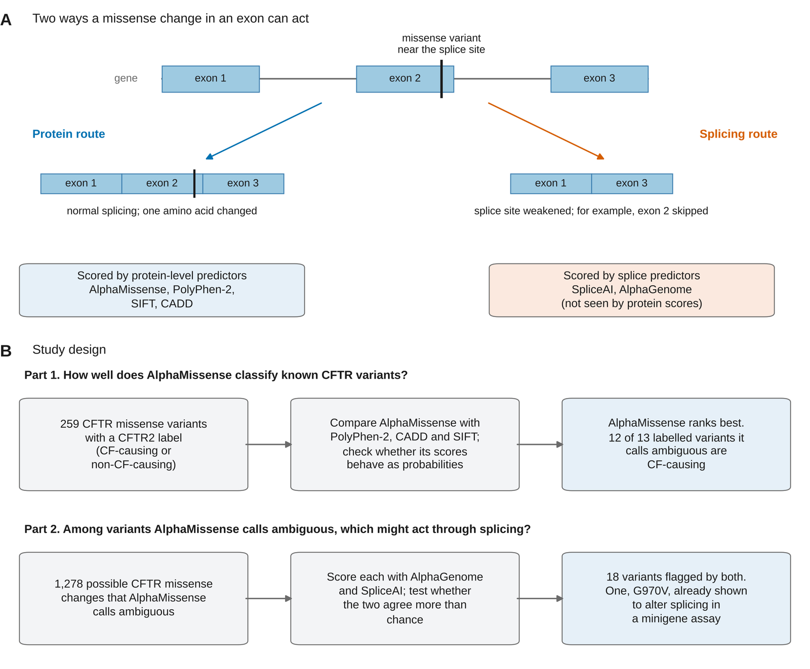
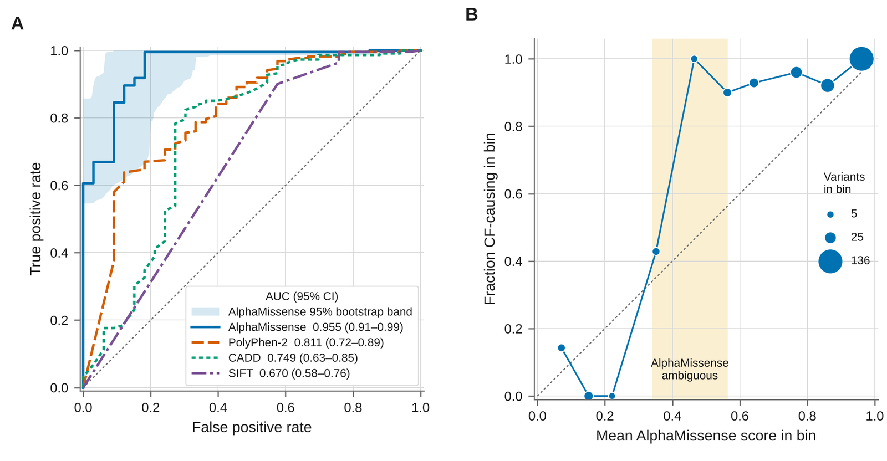
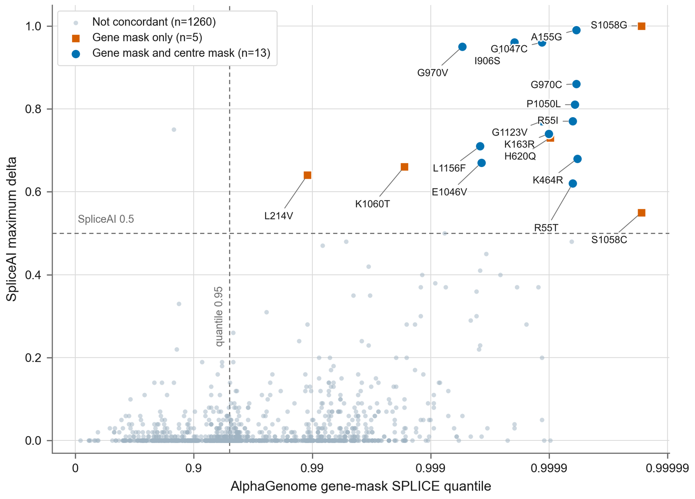
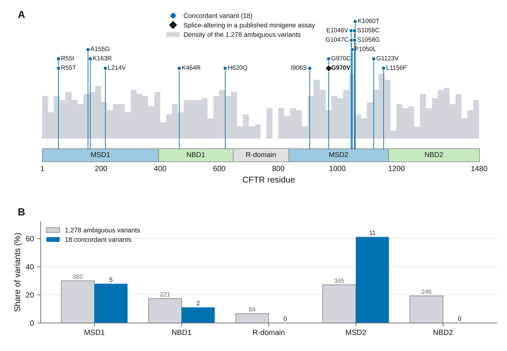
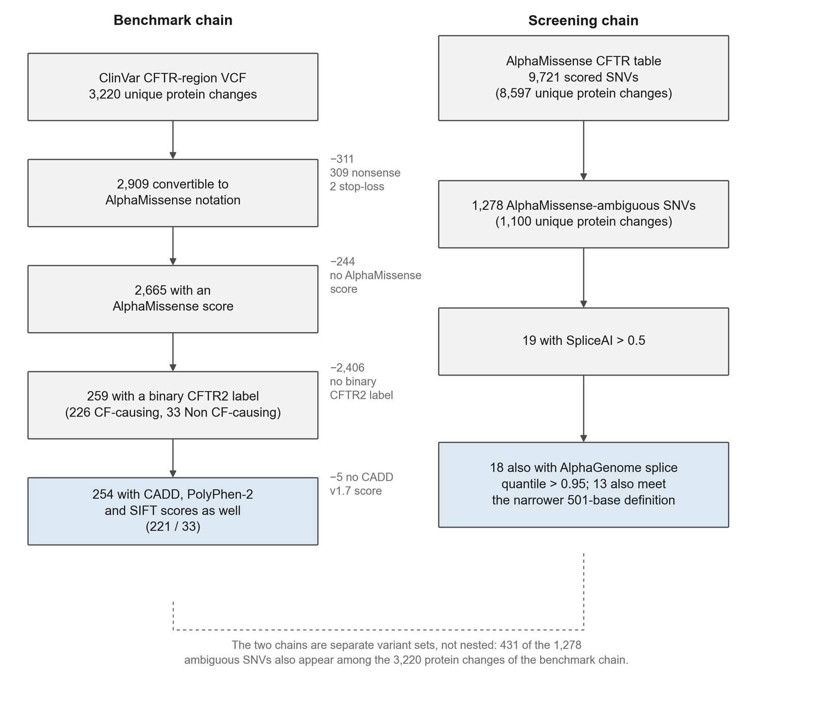

# AlphaMissense classifies known CFTR missense variants well, and two splice predictors agree on 18 of the variants it cannot classify

**Short title.** AlphaMissense and splice prediction for CFTR variants

---

# Authors

Roshani Pawar, Durjya Amonkar, Monika Gostic

# Affiliations

University of Aberdeen, Aberdeen, United Kingdom (Roshani Pawar, Durjya Amonkar, Monika Gostic)

**Corresponding author.** Roshani Pawar (roshani1610pawar@gmail.com)

---

# Abstract

Most missense variants in CFTR, the gene mutated in cystic fibrosis, have no clinical classification. Protein-level predictors can help, but they cannot detect a change that harms the gene by disrupting RNA splicing. We asked how well AlphaMissense classifies CFTR variants of known effect, and whether two splice predictors can point to candidates among the variants it cannot classify. On 257 missense variants labelled in the CFTR2 database, AlphaMissense separated CF-causing from non-CF-causing variants better than PolyPhen-2, CADD and SIFT, with an area under the receiver operating characteristic curve of 0.95. Its scores ranked variants well but should not be read as probabilities: 12 of the 13 labelled variants it called ambiguous were CF-causing. We then scored all 1,278 possible CFTR missense changes in its ambiguous range with SpliceAI and AlphaGenome. The two tools flagged the same variants more often than chance, and 18 variants were flagged by both at high thresholds. Most lie in the second membrane-spanning domain. Four sit at exon edges, at bases or codons where published minigene assays found splicing defects, and one of them, G970V, was itself shown to alter splicing. This work is computational. It supports using AlphaMissense to rank CFTR variants and gives a short list of variants for laboratory testing.

---

# Author Summary

When newborn screening finds a change in the CFTR gene, doctors often cannot say whether it causes cystic fibrosis. Most changes have been seen in too few people to be classified. We tested whether software can help. AlphaMissense, a tool that predicts whether a change to a protein is harmful, separated known disease-causing CFTR changes from non-disease-causing ones better than three older tools. Its scores work as a ranking. They should not be read as the chance that a change causes disease, and the changes it labels "ambiguous" were almost all disease-causing in our data.

A DNA change can also harm a gene in a second way. It can disrupt splicing, the step that joins the coding pieces of the gene's RNA. Protein-based tools cannot see this. For the 1,278 possible CFTR changes that AlphaMissense calls ambiguous, we asked two splicing programs built in different ways. They agreed more often than chance, and both flagged 18 changes. One of these is already known to disrupt splicing.

We did no laboratory work, and we do not claim that any of the 18 causes cystic fibrosis. We provide a short list that a laboratory can test.

---

# Introduction

Cystic fibrosis is caused by loss of function of the CFTR protein [1]. The CFTR2 project assigns disease liability to CFTR variants using clinical, functional and penetrance evidence [2]. Its release of 30 January 2026 covers 2,092 variants seen in 122,935 people with cystic fibrosis [3]. The CFTR region of the ClinVar release we used held 2,782 unique protein changes [4], and most of them have no CFTR2 decision. When newborn screening finds one of these, the result cannot guide care. Laboratories may use computational predictions as evidence, but the standard interpretation guidelines give that evidence the lowest weight they allow [5]. Corvol and colleagues tested common variants, those with a minor allele frequency above 0.5%, in 6,365 patients and found five modifier loci of lung disease severity [6]. We infer that variants carried by only a few people cannot be assessed this way.

Protein-level predictors estimate whether an amino acid change damages the protein. SIFT uses conservation across related sequences [7], PolyPhen-2 combines sequence- and structure-based features [8], and CADD combines many annotations into one score [9]. On CFTR these tools have performed poorly. A comparison of nine predictors scored 779 CFTR missense variants and found none reliable on the 42 that had a clinical label [10]. AlphaMissense scores every possible human missense change. It adapts AlphaFold, uses alignments of related protein sequences, and is fine-tuned on variant frequencies in human and primate populations [11,12]. A CFTR benchmark found that AlphaMissense classified CFTR2 variants fairly well but scored many CFTR variants as pathogenic, giving a high false positive rate. It also could not tell defects in protein expression from defects in channel function [13].

A missense change can also harm CFTR in a way these tools cannot see. A single-nucleotide change inside an exon can weaken a splice site, so that the exon is skipped or shortened in the RNA (Fig 1A). Minigene assays, which test a variant's effect on splicing in cultured cells, have shown this for CFTR. In one study of 15 CFTR exonic variants, six had a major effect on splicing [14]. A second study found that five of eight tested CFTR missense variants alter splicing [15]. Two tools predict splicing from DNA sequence. SpliceAI predicts the gain or loss of splice sites from the sequence around a variant [16]. AlphaGenome predicts splice site use, along with other regulatory signals, from a one-megabase window of sequence [17]. It has been used to choose variants for laboratory testing at one gene, RHD [18]. We found no published use of AlphaGenome on CFTR.

This leaves two questions, which we answer in turn (Fig 1B). How well does AlphaMissense classify CFTR variants that already have a clinical label, and how should its scores be read? For the variants it cannot classify, do two splice predictors built in different ways point to the same candidates? We found that AlphaMissense outperformed PolyPhen-2, CADD and SIFT on 257 CFTR2-labelled variants, with an area under the curve of 0.955, and that the few labelled variants it calls ambiguous were mostly CF-causing. Among 1,278 ambiguous CFTR missense changes, SpliceAI and AlphaGenome agreed more often than chance and both flagged 18 variants, one of which is already known to alter splicing. These 18 are candidates for minigene testing.

**Fig 1. The question and the study design.** (A) A missense change in an exon can act through the amino acid it changes, which protein-level predictors score, or through a splice site it weakens, which splice predictors score. The schematic shows exon skipping as one example of a splicing effect. (B) The study in two parts. Part 1 tests AlphaMissense on CFTR variants with a CFTR2 label. Part 2 applies two splice predictors to the CFTR missense changes that AlphaMissense calls ambiguous.

---

# Results

## AlphaMissense separated CF-causing from non-CF-causing variants better than three older predictors

We tested four predictors on CFTR missense variants that carry a CFTR2 label of CF-causing or non-CF-causing. After duplicate entries were removed, 257 variants remained, 224 CF-causing and 33 non-CF-causing, and all four tools scored every one of them (S1 Fig). AlphaMissense had the highest area under the receiver operating characteristic curve (AUC), 0.955 (95% confidence interval 0.914 to 0.987). PolyPhen-2 reached 0.812, CADD 0.750 and SIFT 0.671 (Table 2, Fig 2A). In a paired test on the same variants, AlphaMissense exceeded each comparator (DeLong p < 0.001). The confidence intervals are wide because only 33 variants are non-CF-causing.

<!-- sources: `results/paper/auc_ci.csv`; `results/phase1/delong_tests_dedup.csv`; `results/phase1/benchmark_metrics_dedup.csv`; `results/phase1/unique_variant_counts.csv`; `docs/paper/tables/Table2_four_tool_benchmark.md` -->

**Table 2. Four predictors on CFTR2-labelled missense variants.** Discrimination against CFTR2 labels on the 257 labelled variants (224 CF-causing, 33 non-CF-causing), all scored by all four tools. Confidence intervals are from 2,000 bootstrap resamples. The last column compares each tool with AlphaMissense on the same variants. The average precision of a random score equals the CF-causing fraction, 0.87.

| Tool | AUC (95% CI) | Average precision (95% CI) | DeLong test vs AlphaMissense |
|---|---|---|---|
| AlphaMissense | 0.955 (0.914–0.987) | 0.992 (0.985–0.998) | reference |
| PolyPhen-2 | 0.812 (0.723–0.891) | 0.957 (0.924–0.982) | Z = 3.49, p = 0.0005 |
| CADD | 0.750 (0.631–0.854) | 0.934 (0.888–0.972) | Z = 3.82, p = 0.0001 |
| SIFT | 0.671 (0.578–0.758) | 0.912 (0.873–0.946) | Z = 6.29, p < 0.0001 |

## AlphaMissense scores rank variants well, and its ambiguous class in CFTR was mostly CF-causing

A good ranking does not mean that a score can be read as a probability. Fig 2B shows the fraction of CF-causing variants against the mean AlphaMissense score in ten score bins. Above a score of 0.4, the fraction CF-causing exceeded the mean score in every bin. The two bins from 0.4 to 0.6 held 15 variants, and 14 of them were CF-causing. The Brier score, the mean squared error of a score read as a probability, was 0.054, against 0.112 for a model that predicts the average rate for every variant.

AlphaMissense also places each variant in one of three classes: likely benign below 0.34, likely pathogenic above 0.564, and ambiguous in between [11]. Table 3 shows how the CFTR2 labels fall across these classes. Of 217 labelled variants in the likely-pathogenic class, 211 were CF-causing. Of 27 in the likely-benign class, 1 was CF-causing. The ambiguous class held only 13 labelled variants, and 12 of them were CF-causing. In this set, the ambiguous class behaved like the likely-pathogenic class. The rest of the study examines this class.

<!-- sources: `results/paper/calibration_n259.csv`; `results/paper/am_class_by_label.csv` -->

**Table 3. AlphaMissense class of the 257 CFTR2-labelled variants.**

| AlphaMissense class | Score range | Labelled variants | CF-causing | Non-CF-causing |
|---|---|---|---|---|
| Likely benign | below 0.34 | 27 | 1 | 26 |
| Ambiguous | 0.34 to 0.564 | 13 | 12 | 1 |
| Likely pathogenic | above 0.564 | 217 | 211 | 6 |

**Fig 2. AlphaMissense ranks CFTR2-labelled variants best, and its scores are under-confident above 0.4.** (A) Receiver operating characteristic curves for four predictors on the 257 labelled variants. The shaded band is the 95% bootstrap interval for AlphaMissense. The legend gives each tool's AUC with its 95% confidence interval. (B) Fraction of CF-causing variants against the mean AlphaMissense score in ten equal-width score bins, for the same 257 variants. Marker area shows the number of variants in each bin. The dashed diagonal marks a score that matches the observed fraction. The shaded band is the AlphaMissense ambiguous range.

## Two splice predictors agreed on the ambiguous variants more often than chance

We then took every possible CFTR missense change that AlphaMissense calls ambiguous, 1,278 single-nucleotide variants (S1 Fig). Most are rare or unseen in the general population: 952 are absent from the gnomAD v4 database. We scored each with AlphaGenome and SpliceAI (Fig 3).

On its own, AlphaGenome flagged most of the set. Of the 1,278 variants, 680 scored above its 0.95 splice quantile. This follows from how the quantile is built. It ranks a variant against common human variants, most of which lie outside genes, so coding variants in a gene with many splice sites tend to rank high (Methods). SpliceAI flagged 52 variants above a score of 0.2 and returned exactly zero for 766. Forty-eight variants were flagged by both tools, against 28 expected if the tools were unrelated (odds ratio 11.3, 95% confidence interval 4.0 to 31.5; χ² p = 8.0 × 10⁻⁹). Because some variants share a genomic position, we repeated the test with one randomly chosen variant per position (940 positions, 500 draws): the median odds ratio was 11.6 (2.5th to 97.5th percentile across draws, 8.0 to 18.4), and the largest Fisher p was 3.3 × 10⁻⁶.

<!-- sources: `results/paper/ag_spliceai_2x2.csv`; `results/paper/position_sensitivity.csv`; `results/paper/concordant_set_origin.csv`; `results/gnomad_cftr_lookup.csv`; `results/alphagenome/alphagenome_full_cftr_results.csv`; `results/comparator_scores.csv` -->

**Fig 3. AlphaGenome and SpliceAI scores for the 1,278 AlphaMissense-ambiguous CFTR missense variants.** Each point is one variant. The horizontal axis is the AlphaGenome splice quantile on a stretched scale, because most values lie close to 1; the axis labels give the quantile itself. The vertical axis is the highest SpliceAI score across the four splice-site channels. Dashed lines mark the thresholds used to define the 18 concordant variants, which are labelled. Blue circles are the 13 that also meet a second, narrower AlphaGenome definition; orange squares are the other 5.

## Eighteen variants were flagged by both predictors, and most lie in the second membrane-spanning domain

At higher thresholds, SpliceAI scored 19 variants above 0.5. AlphaGenome placed 18 of these above its 0.95 splice quantile. The one it did not was Y1381D. These 18 form the concordant set (S1 Table). SpliceAI therefore did the narrowing from 1,278 to 19. Because 53% of all 1,278 variants pass AlphaGenome's threshold, about 10 of the 19 would pass it by chance, so AlphaGenome's agreement with 18 of them is weak support on its own. The association test above is the stronger evidence that the two tools track the same signal. Thirteen of the 18 also met a narrower AlphaGenome definition that considers only splice sites within 250 bases of the variant. None of the 18 has a CFTR2 classification of CF-causing or non-CF-causing. Three have the CFTR2 status "no interpretation available" and 15 have no CFTR2 record. Seven of the 18 appear in the ClinVar extract as the same nucleotide change. Five have a gnomAD v4 allele frequency above zero, and the other 13 are absent from gnomAD v4.

The 18 are not spread evenly along the protein (Fig 4). Eleven lie in the second membrane-spanning domain (MSD2), which holds 27% of the 1,278 ambiguous variants (p = 0.002, two-sided Fisher exact test; p = 0.011 after correction for five domains). Counted by genomic position, 10 of the 16 positions of the 18 lie in MSD2, against 245 of all 940 positions (p = 0.002). This domain test is exploratory. None lies in the R domain or the second nucleotide-binding domain. Six of the 11 MSD2 variants fall within 15 residues, between E1046 and K1060.

Five members sit at bases where a published minigene assay has tested a change, and a sixth shares a split codon with one [14,15]. G970V was tested itself and altered splicing [14]. G970C changes the same base as G970R (c.2908G>C), and K163R the same base as K163M (c.488A>T); both of those changes altered splicing [14,15]. R55T and R55I change the same base as R55K (c.164G>A), which did not alter splicing [14]. Four members sit at exon edges. G970C and G970V change the first and second bases of codon 970, yet their genomic positions are 2,892 bases apart, so an intron separates those two bases: G970C changes the last base of exon 17 and G970V the first base of exon 18 [14]. Codon 1123 is split in the same way. G1123V changes its second base, the first base of exon 21, 2,805 bases from c.3367, the last base of exon 20, where G1123R (c.3367G>C) altered splicing [15]. K163R changes the second-last base of exon 4, where K163M altered splicing [15]. Results at a shared base do not transfer directly. At the G970V base, G970V caused complete skipping of exon 18, while G970D caused partial skipping in one of two minigene constructs [14]. Apart from G970V, no member has its own splicing measurement.

<!-- sources: `results/paper/position_sensitivity.csv` (msd2_position_level); `results/paper/concordant_set_origin.csv` (rows concordant_in_clinvar_vcf_exact_nucleotide, concordant_in_gnomad_v4_af_gt_0); `results/paper/concordant_set.csv` (columns pos_hg38, cftr2_status, gnomad_v4_max_af, in_experimental_benchmark, in_GM, in_CM); `results/paper/domain_distribution.csv`; `results/experimental_benchmark.csv` (rows Gly970Arg, Gly970Val, Gly970Asp, Lys163Met, Arg55Lys, Gly1123Arg; columns hgvs_c, variant_id, minigene_result, source) -->

**Fig 4. Position of the 18 concordant variants on the CFTR protein.** (A) The CFTR protein from residue 1 to 1480 with its five domains. Grey bars show how the 1,278 AlphaMissense-ambiguous variants are distributed along the protein. Each stem marks one concordant variant. G970V, the one member with a published minigene result, is shown as a black diamond. (B) Share of the 1,278 ambiguous variants and of the 18 concordant variants in each domain. Numbers above the bars are counts.

## The available laboratory data are too few to rank the splice predictors

We found 23 CFTR nucleotide changes with a published minigene result, 11 that altered splicing and 12 that did not [14,15]. Both studies chose their variants partly from splice predictions, and one used SpliceAI [14,15], so this set favours the predictors. On these, the AlphaGenome splice quantile reached an AUC of 0.841 (95% confidence interval 0.644 to 0.985). SpliceAI returned exactly zero for 19 of the 23, including the splice-altering G970R, so its AUC on this set cannot be interpreted. With 23 changes and confidence intervals about 0.3 wide, these data cannot show which predictor is better.

<!-- sources: `results/paper/minigene_benchmark.csv`; `results/experimental_benchmark.csv` (gene-mask columns rescored 2026-10-29 by `scripts/paper/p2b_alphagenome_minigene.py`) -->

---

# Discussion

AlphaMissense was the best of the four protein-level predictors at separating CF-causing from non-CF-causing CFTR variants. Its scores worked as a ranking. They did not work as probabilities, and its ambiguous class in CFTR held mostly CF-causing variants. Among the CFTR missense changes it calls ambiguous, two splice predictors built in different ways flagged the same 18 variants, and these cluster in MSD2.

Our AlphaMissense result agrees with the earlier CFTR benchmark in direction [13]. That study reported fair performance with a high false positive rate on 169 CFTR2 missense variants. We used all 257 labelled variants after removing duplicates and measured the AUC, which was 0.955. The two studies differ in variant selection and in the measure reported, so their numbers cannot be compared directly. The ranking of the older tools matches the earlier nine-predictor comparison, in which none was reliable on CFTR [10]. PolyPhen-2, CADD and SIFT also ranked below AlphaMissense here.

The calibration result matters for how laboratories use the score. Guidelines treat a computational prediction as supporting evidence [5]. ClinGen later calibrated PP3 so that computational evidence can reach higher strength [19]. A laboratory may be tempted to read a score of 0.5 as an even chance. In this CFTR2 set that reading is wrong. Of the 15 labelled variants scored between 0.4 and 0.6, 14 were CF-causing. The fraction CF-causing in any bin depends on the mix of variants tested, and this set is 87% CF-causing. Part of the apparent under-confidence comes from that mix. The ambiguous class showed the same pattern: 12 of its 13 labelled variants were CF-causing. The published thresholds were chosen to give 90% precision on ClinVar variants across many genes [11], and were not calibrated for CFTR. Our data suggest that for CFTR the ambiguous range sits mostly on the pathogenic side. The sample is small, and CFTR2 labels are themselves mostly CF-causing (224 of 257), so this needs testing on more non-CF-causing variants before anyone moves a threshold.

Splicing gives one reason why a variant with a moderate AlphaMissense score may still cause disease. Minigene studies show that exonic CFTR variants can disrupt splicing [14,15], and protein-level scores cannot detect that. SpliceAI and AlphaGenome predict splicing from sequence in different ways. SpliceAI reads 5,000 bases either side of each position [16] and, by default, reports changes within 50 bases of the variant [20]. AlphaGenome reads a megabase of sequence and was trained on many kinds of genomic data [17]. They are not fully independent, because both learn from the same annotated genes. Even so, their agreement on the ambiguous set was far above chance. The RHD study ranked variants by AlphaGenome, then kept those present at low frequency in population databases and not previously characterised [18]. Here, the second predictor provides a check.

AlphaGenome did not add much selection on its own. Its splice quantile placed 680 of the 1,278 variants above 0.95, because coding variants in CFTR rank high against a background of mostly non-coding common variants. The narrowing came from SpliceAI. AlphaGenome agreed with 18 of SpliceAI's 19 calls, but about 10 would be expected to pass its threshold by chance. A reader should treat the 18 as SpliceAI predictions that a second, differently built model does not contradict, with the association across all 1,278 variants as the evidence that the two models agree.

The positions of the 18 give a starting point for interpretation. Four members, G970C, G970V, G1123V and K163R, sit at exon edges, where a change at or next to the last or first base of an exon can alter how the splice site is recognised, and other changes at those bases or codons have altered splicing in minigene assays [14,15]. G970V has itself been tested. The three untested ones, G970C, G1123V and K163R, are the natural first targets. The cluster of six variants between E1046 and K1060 suggests that a few sequence regions in MSD2 drive much of the signal. Mapping all 18 to exon boundaries will show whether the others also sit close to splice sites.

## Limitations

The benchmark has only 33 non-CF-causing variants, and every confidence interval in Table 2 is limited by that number. CFTR2 labels are expert decisions based on clinical and functional evidence [2], so agreement with CFTR2 is agreement with that judgement. The AlphaGenome quantile is computed against common variants, which makes its marginal rate uninformative for CFTR coding variants. SpliceAI returned zero for 766 of the 1,278 variants. Its default window is 50 bases either side of a variant, so a zero may mean a splice site was out of range, and SpliceAI cannot serve as a negative control here. The laboratory benchmark has 23 variants and cannot rank the predictors. We placed four of the 18 at exon edges but did not map all 18 to exon boundaries. The AlphaMissense thresholds were set on ClinVar variants [11], which may overlap the CFTR2 labels used here. AlphaGenome is a hosted service, and its scores for the same variants changed between our May, August and October 2026 runs: raw splice scores by up to 3/256, and quantiles by up to 0.73 between August and October. The 501-base score was recomputed with a script rebuilt from the audit description. Across 634 variants at single-allele positions it matched the earlier values with a median difference of 0.002 (largest 0.012). Download dates were not recorded for the CFTR2, AlphaMissense, CADD, SpliceAI and gnomAD data. This work is computational, and no variant discussed here is claimed to cause cystic fibrosis.

## Next steps

A minigene panel of the 17 untested concordant variants would test the prediction directly. It would report how many of the 17 alter splicing. If most do, agreement between SpliceAI and AlphaGenome is a useful way to choose CFTR variants for laboratory work. If few do, that agreement does not predict a measurable effect.

## Conclusion

Many rare CFTR variants are left ambiguous by protein-level scores. AlphaMissense is the best of the protein-level tools we tested on CFTR. Its scores should be read as a ranking, and in a small sample its ambiguous class in CFTR was mostly CF-causing. For variants in that class, SpliceAI, supported by AlphaGenome, reduces 1,278 candidates to 18 that a laboratory can test. One is already known to alter splicing, and three more sit at exon edges where other changes have altered splicing.

---

# Materials and Methods

## Data sources

Table 1 lists every data source with its version and date. S1 Fig shows how each variant set was built.

**Table 1. Data sources.**

| Source | Version | Date | Used for |
|---|---|---|---|
| CFTR2 database | release of 30 January 2026 | download date not recorded; file dated 14 May 2026 | Clinical labels |
| ClinVar, CFTR region | VCF dated 15 April 2026 | extracted 21 April 2026 | Variant inventory |
| Ensembl VEP | v115.1, GRCh38.p14 cache | 21 April 2026 | SIFT and PolyPhen-2 scores |
| AlphaMissense | Zenodo record 8208688 | download date not recorded | Pathogenicity scores and classes |
| CADD | v1.7, GRCh38 | query date not recorded | Comparator score |
| SpliceAI | Ensembl VEP REST plugin; version not recorded | query date not recorded | Splice scores |
| AlphaGenome | SDK v0.6.1; calibration served on the scoring date | scored 27 October 2026 | Splice scores |
| gnomAD | v4 | query date not recorded | Population frequency |
| Minigene results | two published studies [14,15] | compiled 2 August 2026 | Laboratory benchmark |

<!-- sources: `docs/paper/tables/Table1_data_sources.md` -->

## Variant inventory and clinical labels

Variants were taken from the CFTR region (chr7:117,480,000 to 117,670,000) of a ClinVar VCF dated 15 April 2026. The region was extracted with bcftools 1.23.1 on 21 April 2026, normalised, and annotated with Ensembl VEP v115.1 [21] against the GRCh38.p14 cache. The file holds variant sites only and no patient data. A regular expression was applied to the VEP annotation to extract protein changes. A protein change was counted only when the full HGVS protein name on a line was a single amino acid substitution or a stop-gain (for example p.Arg117His or p.Gly542Ter); names that are the start of a frameshift or extension, such as p.Lys163ArgfsTer3, were not counted. This gave 2,782 unique protein changes. Clinical labels came from the CFTR2 release of 30 January 2026.

<!-- sources: `notebooks/cftr2_scraper.ipynb`; `scripts/cftr2_scraper_analysis.py`; `scripts/hgvsp_names.py`; `data/All_Variants_VEP.Gene.vcf`; `data/cftr2_variants.xlsx`; `data/cftr2_results.csv`; `results/phase1/unique_variant_counts.csv`; `audit/COHORT_PROVENANCE.md` -->

## AlphaMissense scores

AlphaMissense scores for hg38 were taken from Zenodo record 8208688 and filtered to CFTR (UniProt P13569, transcript ENST00000003084.10), giving 9,721 single-nucleotide variants. Protein changes from the VCF were converted to AlphaMissense notation. Conversion failed for 309 changes, all nonsense, which AlphaMissense does not score. After merging, 2,471 protein changes had a score. Each variant carries the published AlphaMissense class: likely benign below 0.34, likely pathogenic above 0.564, and ambiguous in between [11].

<!-- sources: `notebooks/alphamissense.ipynb`; `scripts/alphamissense_analysis.py`; `data/cftr_alphamissense.tsv`; `data/cftr2_results_annotated.csv`; `results/phase1/unique_variant_counts.csv`; `results/phase1/SOURCE.md` -->

## Benchmark set

The benchmark set was every protein change with an AlphaMissense score and a CFTR2 label of CF-causing or non-CF-causing. Because one protein change can arise from several nucleotide changes, the merge gave 290 rows for 257 unique protein changes. Duplicate rows never differed in label or score. We kept the first row for each protein change, leaving 257 variants (224 CF-causing, 33 non-CF-causing). All analyses used this deduplicated set.

<!-- sources: `scripts/phase1_build_cohort.py`; `results/phase1/benchmark_cohort_dedup.csv`; `results/phase1/unique_variant_counts.csv`; `docs/AUDIT_RECORD.md` -->

## Comparator scores

CADD v1.7 scores came from the CADD GRCh38 web service. SIFT and PolyPhen-2 scores came from the VEP annotation. SIFT scores were inverted (one minus the score) so that a higher value means more damaging for every tool. All 257 variants had all four scores.

<!-- sources: `scripts/phase1_fetch_cadd.py`; `scripts/fetch_comparator_scores.py`; `results/phase1/inputs_cadd_scores.csv`; `results/phase1/inputs_polyphen_sift.csv`; `results/phase1/benchmark_cohort_dedup.csv` -->

## Discrimination, paired comparison and calibration

For each tool we computed the AUC and the average precision with scikit-learn. Confidence intervals came from 2,000 bootstrap resamples of the variants (seed 42), with the same resamples used for all four tools. Each comparator was compared with AlphaMissense on the same 257 variants by the DeLong test for paired ROC curves [22], using the implementation of Sun and Xu [23]. For calibration, the 257 variants were placed in ten equal-width bins by AlphaMissense score. For each bin we recorded the number of variants, the mean score and the fraction CF-causing. We also computed the Brier score and the Brier score of a model that predicts the overall CF-causing rate for every variant. Finally, we counted labelled variants in each AlphaMissense class.

<!-- sources: `scripts/paper/p3a_auc_ci.py`; `results/paper/auc_ci.csv`; `scripts/phase1_delong.py`; `scripts/phase1_utils_delong.py`; `results/phase1/delong_tests_dedup.csv`; `scripts/paper/p3b_calibration.py`; `results/paper/calibration_n259.csv`; `scripts/paper/p3f_class_and_domain.py`; `results/paper/am_class_by_label.csv` -->

## The ambiguous set

The splice analysis used every CFTR single-nucleotide variant in the AlphaMissense table with an ambiguous score (0.34 to 0.564): 1,278 variants. This set covers all possible missense changes in the ambiguous range, so it is not drawn from ClinVar; 386 of the 1,278 also appear among the 2,782 ClinVar protein changes. Population frequencies were looked up in gnomAD v4: 952 variants were absent, 291 had a frequency above zero, and 35 had a record without a frequency.

<!-- sources: `data/cftr_alphamissense.tsv`; `results/alphagenome/alphagenome_full_cftr_results.csv`; `results/gnomad_cftr_lookup.csv`; `results/paper/fig1_flow_counts.csv`; `audit/COHORT_PROVENANCE.md` -->

## AlphaGenome scoring

The 1,278 variants were scored with AlphaGenome (SDK v0.6.1) on 27 October 2026 using lung tissue tracks (UBERON:0002048), and each result was matched to its variant by position and both alleles. We used the splice site usage output. The main score takes the largest change in splice site use anywhere in the CFTR gene. A narrower score considers only a 501-base window centred on the variant. AlphaGenome reports each score as a quantile against a background of common variants, those above 1% frequency in any gnomAD v3 population [24]. AlphaGenome changed its quantile background on 18 June 2026, as announced on 11 June [25]. The quantiles used here are the ones the service returned on 27 October 2026.

<!-- sources: `scripts/alphagenome_full_cftr.py`; `scripts/paper/p2_alphagenome_centremask.py`; `results/alphagenome/alphagenome_full_cftr_results.csv`; `results/alphagenome/rescore_centermask.csv`; `results/alphagenome/SOURCE.md`; `docs/paper/OPEN_ITEMS.md` (E0); `docs/AUDIT_RECORD.md`; `audit/PROVENANCE.md` -->

## SpliceAI scoring

SpliceAI scores for the 1,278 variants were Illumina's precomputed scores, retrieved through the Ensembl VEP SpliceAI plugin [16,21]. We used the highest of the four scores (acceptor gain, acceptor loss, donor gain, donor loss). Variants that returned exactly zero were queried again to separate a true zero from a missing record. All 766 zeros were true zeros with a record present.

<!-- sources: `scripts/fetch_comparator_scores.py`; `scripts/fix_spliceai_scores.py`; `scripts/reclassify_spliceai_zeros.py` (766 GENUINE_ZERO); `results/comparator_scores.csv`; `results/spliceai_zero_reclassification.csv`; `docs/AUDIT_RECORD.md` -->

## Agreement between the splice predictors

Agreement was tested on a two-by-two table of AlphaGenome splice quantile above 0.95 against SpliceAI above 0.2, with Pearson's chi-square test and Fisher's exact test (SciPy). The odds ratio is reported with a 95% Woolf interval. The SpliceAI thresholds of 0.2 and 0.5 are the developers' high-recall and recommended cut-offs [20]; the AlphaGenome threshold of a 0.95 quantile was our choice. Because some of the 1,278 variants share a genomic position, we repeated the test 500 times, each time keeping one randomly chosen variant per position (940 positions, seed 42), and recorded the median odds ratio, its 2.5th and 97.5th percentiles across draws, and the median and largest Fisher p.

<!-- sources: `scripts/paper/p3e_ag_spliceai_2x2.py`; `results/paper/ag_spliceai_2x2.csv`; `scripts/paper/p3g_position_sensitivity.py`; `results/paper/position_sensitivity.csv` -->

## The concordant set

The concordant set was defined as variants with SpliceAI above 0.5 and AlphaGenome splice quantile above 0.95. A narrower definition used the 501-base AlphaGenome score in the top 5% of the 1,278 (threshold 0.0692) with the same SpliceAI criterion. For each variant we recorded its position, scores, CFTR2 status, gnomAD frequency and any minigene result. Domains were assigned by residue number (MSD1 1 to 394, NBD1 395 to 646, R domain 647 to 835, MSD2 836 to 1172, NBD2 1173 to 1480). For each domain, a two-sided Fisher exact test compared the concordant variants with the other 1,260, and p-values were also given with a Bonferroni correction for five domains. The MSD2 test was repeated with genomic positions in place of variants, comparing the positions of the 18 with all 940 positions of the 1,278. We counted how many of the 18 appear in the ClinVar VCF as the same nucleotide change, and how many have a gnomAD v4 allele frequency above zero. For codons 970 and 1123, the codon position of each change was inferred from the amino acid change: a glycine codon (GGN) becomes cysteine or arginine only by a change at the first base, and valine or aspartate only by a change at the second. A codon whose first and second bases lie thousands of bases apart in the genome is split by an intron. Minigene results at the same genomic base were matched by position.

<!-- sources: `scripts/paper/p3c_concordant_set.py`; `results/paper/concordant_set.csv`; `scripts/paper/p3f_class_and_domain.py`; `results/paper/domain_distribution.csv`; `results/paper/concordant_set_origin.csv`; `scripts/paper/p3g_position_sensitivity.py`; `results/paper/position_sensitivity.csv`; `data/All_Variants_VEP.Gene.vcf`; `results/gnomad_cftr_lookup.csv` -->

## Minigene benchmark

We compiled 23 CFTR nucleotide changes (22 variants; E403D occurs as two different nucleotide changes) with published minigene results from two studies [14,15]: 11 that altered splicing and 12 that did not. A change was coded splice-altering when the study reported a major effect on splicing (six changes in [14], five in [15]) and not splice-altering otherwise, including three changes with partial effects in [14] (G970D, I918M and R1070Q). AlphaGenome gene-mask scores for these 23 changes were recomputed on 29 October 2026 with the same scorer, tracks and exact variant matching as the 1,278. For each predictor we computed the AUC with a bootstrap confidence interval (2,000 resamples, seed 42).

<!-- sources: `scripts/paper/p2b_alphagenome_minigene.py`; `scripts/paper/p3d_minigene_benchmark.py`; `results/paper/minigene_benchmark.csv`; `results/experimental_benchmark.csv` (column minigene_result, source); `docs/experimental_benchmark.md` -->

## Software

Analyses used Python 3.13.1 with NumPy 2.4.6, pandas 2.3.3, scikit-learn 1.9.0, SciPy 1.17.1 and Matplotlib 3.10.9. Every random procedure used seed 42.

<!-- sources: `scripts/paper/figstyle.py`; `scripts/paper/p4_fig1_design.py`; `scripts/paper/p4_fig2_roc.py`; `scripts/paper/p4_fig3_scatter.py`; `scripts/paper/p4_fig4_domain_map.py`; `scripts/paper/p4_fig1_flow.py`; `scripts/paper/p4_tables.py`; `scripts/paper/p4_previews.py` -->

---

# Data Availability Statement

All code and derived results are in the project repository on GitHub (https://github.com/RoshaniPawar16/alphamissense-cftr), branch `main`. An archived copy will be deposited in Zenodo before publication. Four input files are not in the repository and can be rebuilt from public sources: the AlphaMissense hg38 scores (Zenodo record 8208688); the same file filtered to CFTR; the ClinVar VCF of 15 April 2026 restricted to the CFTR region and annotated with Ensembl VEP v115.1; and the CFTR2 release of 30 January 2026 (cftr2.org) merged with the AlphaMissense scores. CADD, SpliceAI and gnomAD scores are available from their public services. The AlphaGenome scores used here are in the repository.

---

# Funding

The authors received no specific funding for this work.

# Competing interests

The authors have declared that no competing interests exist.

# Author contributions

**Roshani Pawar:** Conceptualization, Data curation, Formal analysis, Investigation, Methodology, Software, Visualization, Writing – original draft.

**Durjya Amonkar:** Conceptualization, Investigation, Writing – review & editing.

**Monika Gostic:** Supervision, Writing – review & editing.

---

# References

1. Elborn JS. Cystic fibrosis. Lancet. 2016;388(10059):2519-2531. doi:10.1016/S0140-6736(16)00576-6
2. Sosnay PR, Siklosi KR, Van Goor F, Kaniecki K, Yu H, Sharma N, et al. Defining the disease liability of variants in the cystic fibrosis transmembrane conductance regulator gene. Nat Genet. 2013;45(10):1160-1167. doi:10.1038/ng.2745
3. CFTR2. Clinical and functional translation of CFTR [Internet]. [cited 2026 Oct 29]. Available from: https://cftr2.org
4. Landrum MJ, Chitipiralla S, Kaur K, Brown G, Chen C, Hart J, et al. ClinVar: updates to support classifications of both germline and somatic variants. Nucleic Acids Res. 2025;53(D1):D1313-D1321. doi:10.1093/nar/gkae1090
5. Richards S, Aziz N, Bale S, Bick D, Das S, Gastier-Foster J, et al. Standards and guidelines for the interpretation of sequence variants: a joint consensus recommendation of the American College of Medical Genetics and Genomics and the Association for Molecular Pathology. Genet Med. 2015;17(5):405-424. doi:10.1038/gim.2015.30
6. Corvol H, Blackman SM, Boëlle PY, Gallins PJ, Pace RG, Stonebraker JR, et al. Genome-wide association meta-analysis identifies five modifier loci of lung disease severity in cystic fibrosis. Nat Commun. 2015;6:8382. doi:10.1038/ncomms9382
7. Ng PC, Henikoff S. SIFT: predicting amino acid changes that affect protein function. Nucleic Acids Res. 2003;31(13):3812-3814. doi:10.1093/nar/gkg509
8. Adzhubei IA, Schmidt S, Peshkin L, Ramensky VE, Gerasimova A, Bork P, et al. A method and server for predicting damaging missense mutations. Nat Methods. 2010;7(4):248-249. doi:10.1038/nmeth0410-248
9. Kircher M, Witten DM, Jain P, O'Roak BJ, Cooper GM, Shendure J. A general framework for estimating the relative pathogenicity of human genetic variants. Nat Genet. 2014;46(3):310-315. doi:10.1038/ng.2892
10. Michels M, Matte U, Fraga LR, Mancuso ACB, Ligabue-Braun R, Berneira EFR, et al. Determining the pathogenicity of CFTR missense variants: multiple comparisons of in silico predictors and variant annotation databases. Genet Mol Biol. 2019;42(3):560-570. doi:10.1590/1678-4685-GMB-2018-0148
11. Cheng J, Novati G, Pan J, Bycroft C, Žemgulytė A, Applebaum T, et al. Accurate proteome-wide missense variant effect prediction with AlphaMissense. Science. 2023;381(6664):eadg7492. doi:10.1126/science.adg7492
12. Jumper J, Evans R, Pritzel A, Green T, Figurnov M, Ronneberger O, et al. Highly accurate protein structure prediction with AlphaFold. Nature. 2021;596(7873):583-589. doi:10.1038/s41586-021-03819-2
13. McDonald EF, Oliver KE, Schlebach JP, Meiler J, Plate L. Benchmarking AlphaMissense pathogenicity predictions against cystic fibrosis variants. PLoS One. 2024;19(1):e0297560. doi:10.1371/journal.pone.0297560
14. Bergougnoux A, Billet A, Ka C, Heller M, Degrugillier F, Vuillaume ML, et al. The multi-faceted nature of 15 CFTR exonic variations: impact on their functional classification and perspectives for therapy. J Cyst Fibros. 2023;22(3):515-524. doi:10.1016/j.jcf.2022.12.003
15. Zhang B, Zhang Y, Zhang Y, Liu X, Zhang R, Wang Z, et al. Identified five variants in CFTR gene that alter RNA splicing by minigene assay. Front Genet. 2025;16:1543623. doi:10.3389/fgene.2025.1543623
16. Jaganathan K, Kyriazopoulou Panagiotopoulou S, McRae JF, Darbandi SF, Knowles D, Li YI, et al. Predicting splicing from primary sequence with deep learning. Cell. 2019;176(3):535-548.e24. doi:10.1016/j.cell.2018.12.015
17. Avsec Ž, Latysheva N, Cheng J, Novati G, Taylor KR, Ward T, et al. Advancing regulatory variant effect prediction with AlphaGenome. Nature. 2026;649(8099):1206-1218. doi:10.1038/s41586-025-10014-0
18. Liu M, Shen Z, Jeong YK, Yu N, Wu S-C, Wittig A, et al. AlphaGenome-enabled analysis of non-coding regulatory variants underlying RHD expression with wet-lab validation. bioRxiv [Preprint]. 2026. doi:10.64898/2026.01.21.700828
19. Pejaver V, Byrne AB, Feng BJ, Pagel KA, Mooney SD, Karchin R, et al. Calibration of computational tools for missense variant pathogenicity classification and ClinGen recommendations for PP3/BP4 criteria. Am J Hum Genet. 2022;109(12):2163-2177. doi:10.1016/j.ajhg.2022.10.013
20. Illumina. SpliceAI [Internet]. GitHub; [cited 2026 Oct 29]. Available from: https://github.com/Illumina/SpliceAI
21. McLaren W, Gil L, Hunt SE, Riat HS, Ritchie GRS, Thormann A, et al. The Ensembl Variant Effect Predictor. Genome Biol. 2016;17:122. doi:10.1186/s13059-016-0974-4
22. DeLong ER, DeLong DM, Clarke-Pearson DL. Comparing the areas under two or more correlated receiver operating characteristic curves: a nonparametric approach. Biometrics. 1988;44(3):837-845. doi:10.2307/2531595
23. Sun X, Xu W. Fast implementation of DeLong's algorithm for comparing the areas under correlated receiver operating characteristic curves. IEEE Signal Process Lett. 2014;21(11):1389-1393. doi:10.1109/LSP.2014.2337313
24. AlphaGenome documentation. Frequently asked questions [Internet]. Google DeepMind; [cited 2026 Oct 27]. Available from: https://www.alphagenomedocs.com/faqs.html
25. AlphaGenome team. Updating variant score quantiles [Internet]. AlphaGenome Community; 2026 Jun 11 [cited 2026 Oct 27]. Available from: https://www.alphagenomecommunity.com/t/updating-variant-score-quantiles/929

---

# Supporting information

**S1 Fig. How the two variant sets were built.** Left, the benchmark set: from 2,782 unique protein changes in the ClinVar CFTR region to 257 variants with a CFTR2 label, all of which have all four predictor scores. Right, the ambiguous set: from 9,721 scored CFTR single-nucleotide variants in the AlphaMissense table to the 1,278 in the ambiguous range, the 19 with a SpliceAI score above 0.5, and the 18 of these that also pass the AlphaGenome threshold. The two sets are separate; 386 of the 1,278 also appear among the 2,782.

**S1 Table. The 18 concordant variants.** Position, domain, AlphaMissense score, AlphaGenome and SpliceAI scores, SpliceAI channel, gnomAD v4 frequency, CFTR2 status, minigene result, and membership of each definition. File: `docs/paper/tables/S1_Table_concordant_set.md`; full columns: `results/paper/concordant_set.csv`.
